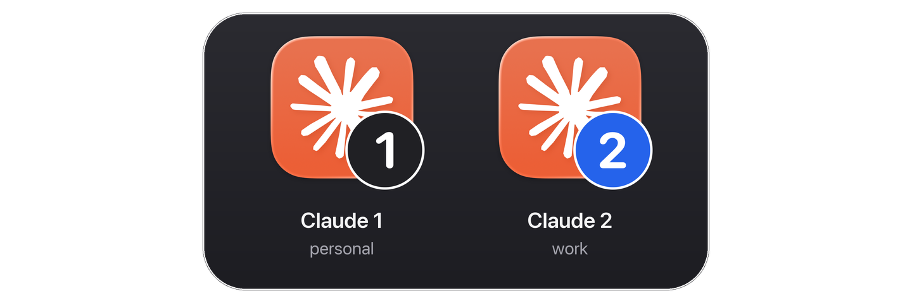
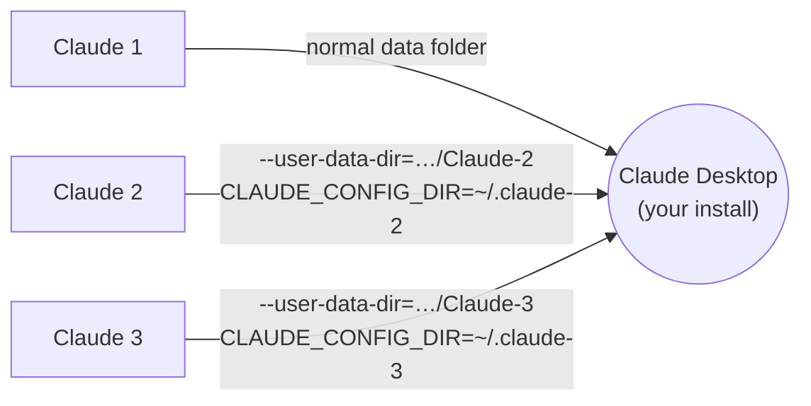

<div align="center">

# Claude Desktop Profiles

**Run your personal and work Claude accounts at the same time, on Mac or Windows.**


[](LICENSE)



</div>

Claude Desktop signs in to one account at a time. This adds numbered launchers,
**Claude 1**, **Claude 2** and so on, and each one opens Claude signed in to its own
account. They run side by side, each with its own chats, settings and Claude
Code sessions.

- **Nothing is patched or copied.** Every launcher opens your normal Claude, so
  updates keep arriving for all of them.
- **Your current setup stays put.** The Claude you already use becomes Claude 1,
  still signed in.
- **Numbered icons.** Made on your machine from your installed Claude's icon.
- **One click to switch.** Clicking an account that's already open brings its
  window forward instead of starting a second copy.

> [!NOTE]
> Unofficial and not affiliated with Anthropic. It relies on a startup flag that
> Claude Desktop doesn't officially support, so a future update could break it.
> Uninstalling takes one command and never deletes your logins.

## Install

First get a copy: click the green **Code** button at the top of this page and
choose **Download ZIP**, or copy the URL there and `git clone` it. Name the
folder `claude-desktop-profiles` (a ZIP unzips as `claude-desktop-profiles-main`).

### With Claude Code (easiest)

Put the folder in your skills folder as `~/.claude/skills/claude-desktop-profiles`,
then tell Claude: *"set up a second Claude account"*. It checks your system, asks
how many accounts you want, runs the installer and walks you through the first
sign-in.

### macOS

Needs Claude Desktop in `/Applications` and Apple's command line tools
(`xcode-select --install`). In Terminal, from the folder that contains
`claude-desktop-profiles`:

```bash
claude-desktop-profiles/scripts/macos/install.sh 2 --copy-code-settings
```

**Claude 1** and **Claude 2** replace the plain Claude icon in your Dock.

### Windows

Needs Claude Desktop from [claude.ai/download](https://claude.ai/download) or the
Microsoft Store. No admin rights needed. In PowerShell, from the folder that
contains `claude-desktop-profiles`:

```powershell
powershell -ExecutionPolicy Bypass -File claude-desktop-profiles\scripts\windows\install.ps1 -Count 2 -CopyCodeSettings
```

**Claude 1** and **Claude 2** appear in the Start menu and on the Desktop. To pin
one, right-click it in the Start menu and choose **Pin to taskbar** (under
**More** on Windows 11). Pin the launcher itself, not the running Claude window.
Windows doesn't allow scripts to pin.

### Options

| | macOS | Windows |
|---|---|---|
| Number of accounts (2–9, default 2) | `install.sh 3` | `-Count 3` |
| Give new accounts' Code tab your `CLAUDE.md` and skills | `--copy-code-settings` | `-CopyCodeSettings` |
| Leave the Dock / Desktop alone | `--no-dock` | `-NoDesktop` |
| Use a Claude installed somewhere unusual | | `-ClaudeExe <path>` |

Running the installer again is safe. It rebuilds the launchers and keeps every
login.

## First sign-in

1. **Quit Claude 1 completely** (Mac: <kbd>Cmd</kbd>+<kbd>Q</kbd>; Windows: tray
   icon → Quit). Your browser hands sign-in back to "Claude", and every account
   shares that link. If Claude 1 is open, the sign-in can end up there.
2. Open **Claude 2** and sign in with your other account.
3. Reopen Claude 1. Both now stay signed in.

On a Mac, the first click asks *"Claude 2 wants to control Claude"*. Click
**Allow**. It lets a click bring back a window you closed with the red button.

## Uninstall

| | |
|---|---|
| macOS | `claude-desktop-profiles/scripts/macos/uninstall.sh` |
| Windows | `powershell -ExecutionPolicy Bypass -File claude-desktop-profiles\scripts\windows\uninstall.ps1` |

Pass a number to remove one launcher (`uninstall.sh 3`, `-Number 3`). On a Mac
the plain Claude icon goes back in the Dock. Logins and chats are kept, and the
script prints where they are.

## How it works

Claude Desktop is an Electron app. Electron accepts a `--user-data-dir` flag,
and the data folder is where the login lives. Each launcher starts the same
Claude with a different folder:



| | macOS | Windows |
|---|---|---|
| Launcher | `/Applications/Claude N.app`, a shell script plus a small Swift helper | `Claude N.lnk` shortcuts running a hidden PowerShell script |
| Account data | `~/Library/Application Support/Claude-N` | `%APPDATA%\Claude-N` |
| Claude Code settings | `~/.claude-N` | `%USERPROFILE%\.claude-N` |
| Already open? | Brings that window forward, reopening it if you closed it | Claude's lock (one per data folder) brings it forward |
| Finding Claude | `/Applications/Claude.app` | Looked up on every launch, so updates don't break it |

Claude 1 always uses Claude's default folder, so nothing about your current
setup moves. The Mac installer backs up your Dock layout before each change to
`~/Library/Application Support/claude-desktop-profiles/`.

## Good to know

- **Same icon while running.** The numbered icons are on the launchers. Once
  Claude is open, the Dock or taskbar shows the normal Claude icon for every
  account. The account name at the bottom of Claude's sidebar tells you which one
  you're in.
- **Connectors that sign in through the browser** (MCP OAuth) have the same
  routing quirk as sign-in. Quit the other accounts while you connect one.
- **Windows: one Cowork workspace at a time.** Claude's Cowork VM runs one per
  PC, so quit one account before using Cowork in another.
- **Testing.** Every push runs the installer, launchers and uninstaller on real
  macOS and Windows machines in CI. The Claude used there is a stand-in that
  records how it was started. Day-to-day use on a Mac has been tested by hand
  with Claude Desktop itself. Windows with the real Claude has not been yet;
  please [open an issue](../../issues)
  if something's off.

## Credits

This builds on what others worked out first. No code was copied.

- [aoxborrow's gist](https://gist.github.com/aoxborrow/5a3a0ac0aa37819cc19439b70a552221)
  (crediting Philipp Stracker): the Mac launcher-app approach, reopening closed
  windows, and telling Claude's main process from its helpers.
- [vodongha/claude-desktop-clone](https://github.com/vodongha/claude-desktop-clone):
  finding Claude's Windows Store install with `Get-AppxPackage`, and the
  `%APPDATA%` requirement for Cowork.
- [frogbark/trackmyusage](https://github.com/frogbark/trackmyusage): documents
  the sign-in routing problem. Its per-app-copy approach routes it exactly, if
  you need that.

See also [sarhej/claude-fix](https://github.com/sarhej/claude-fix) and
[jmdarre-v/claude-multiprofile](https://github.com/jmdarre-v/claude-multiprofile).

## License

[MIT](LICENSE)
